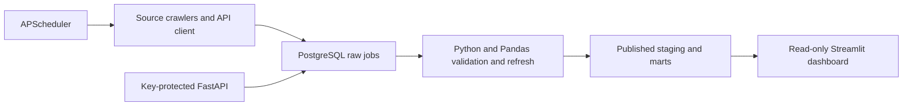

# Job Market Analytics Pipeline

This project collects job postings from CareerViet, TopDev, and Arbeitnow, validates and loads them into PostgreSQL, and publishes analytics for Streamlit. It tracks postings in the collected sample.



## Run the demo

Install Docker with Compose. Create `.env` from `.env.example` with `cp .env.example .env` on macOS/Linux or `Copy-Item .env.example .env` in PowerShell. Start with a fresh demo database.

```sh
docker compose up -d --build --wait
```

Load the synthetic sample. Use `cat database/demo_seed.sql` on macOS/Linux or `Get-Content -Raw database/demo_seed.sql` in PowerShell as the left side of the pipe.

```powershell
Get-Content -Raw database/demo_seed.sql | docker compose exec -T postgres sh -c 'psql -v ON_ERROR_STOP=1 -U "$POSTGRES_USER" -d "$POSTGRES_DB"'
docker compose run --rm --build etl python pipeline.py
```

Open the [local dashboard](http://localhost:8501). With the sample only, **Demo Board A → Hồ Chí Minh** should show two postings, both mentioning SQL. The salary chart should show an average range midpoint of VND 27.5M/month from two postings. The sample can be replayed using the same keys.

## Use live sources

```sh
docker compose run --rm --build etl python scheduler.py --once
docker compose --profile etl up -d --build etl
docker compose logs -f etl
```

The scheduler runs at startup and at 07:00 Vietnam time each day. `INGEST_SOURCES` selects any combination of `careerviet,topdev,arbeitnow`. The connectors collect a bounded sample. A crawler that cannot identify listings, or that loses part of a requested batch, fails closed. A valid empty API response is allowed. If a selected source fails, the scheduled run keeps the last published snapshot and records each source attempt in `ingestion_runs`. Successful source writes to raw remain available for a later retry. The log includes skipped records and reconciliation counts.

If a run fails, check the source and error in the ETL logs. Confirm whether the source changed its HTML, returned a rate limit, or timed out. Once it recovers, rerun `scheduler.py --once`. If the source is unavailable for longer, you can explicitly select the remaining sources in `.env`. Historical postings already collected from the unavailable source remain in the reports. For a refresh from existing raw data, stop the scheduler first and run `python pipeline.py` in the ETL service.

## Data and access rules

| Output | Definition |
| --- | --- |
| Posting | One listing per source, identified by its external ID when available, then by its canonical URL, then by normalized title, company and location within that source. The fallback can conflate similar listings. |
| Skill share | Distinct filtered postings mentioning the skill divided by filtered postings with a description. A posting can mention multiple skills, and extraction only covers the configured terms and aliases. |
| Daily postings | Filtered postings with a known posting date, grouped by that date. A selected date range excludes unknown dates. Missing dates are reported when included in the current cohort. |
| Salary | Average midpoint of comparable VND/month ranges or exact amounts, with sample size. The database mart keeps currency and pay period separate. |
| Publication | Staging and marts are validated and replaced in one PostgreSQL transaction. The dashboard reads one staged snapshot and applies the same source, location and date filters. |

Streamlit connects as `job_market_dashboard` and can only read the published staging relation. Raw descriptions and contact text stay out of the published dashboard data. The FastAPI routes under `/jobs` are disabled until `JOB_API_KEY` is set in `.env`. Send that value in the `X-API-Key` header. `GET /jobs/?limit=100&offset=0` paginates the authenticated raw records. `GET /health` checks the PostgreSQL connection. Compose binds service ports to localhost.

## Upgrade an existing PostgreSQL volume

Add `DASHBOARD_DB_PASSWORD` to the existing `.env`, choose a password, and stop active ETL and application services before migrating. Take a database backup using your existing process. Then run from the repo root.

```sh
docker compose --profile etl stop etl backend streamlit
docker compose up -d --wait postgres
docker compose exec -T postgres sh -c 'for migration in /docker-entrypoint-initdb.d/0[234]_*.sql; do psql -v ON_ERROR_STOP=1 -U "$POSTGRES_USER" -d "$POSTGRES_DB" -f "$migration" || exit; done'
docker compose run --rm --build etl python pipeline.py
docker compose up -d --build --wait
```

The identity migration keeps the lowest original ID when legacy keys resolve to the same listing. It preserves the other original records in `raw_jobs_identity_archive`, with a reference to the retained ID. The report refresh populates the new staging columns for existing data.

## Tests

```sh
python -m pip install -r etl/requirement.txt -r dashboard/requirements.txt
python -m unittest discover -s tests -v
```

The fixtures cover source failures, repeat ingestion, metric scope, and atomic reporting. To run the PostgreSQL integration checks, initialize an empty disposable database named `job_market_test` with the scripts in `database/init` and set `TEST_DATABASE_URL` to its connection URL. Run `tests/test_identity.sql` with `psql -v ON_ERROR_STOP=1` against the same test database to verify the shared upsert and deduplication rules.
